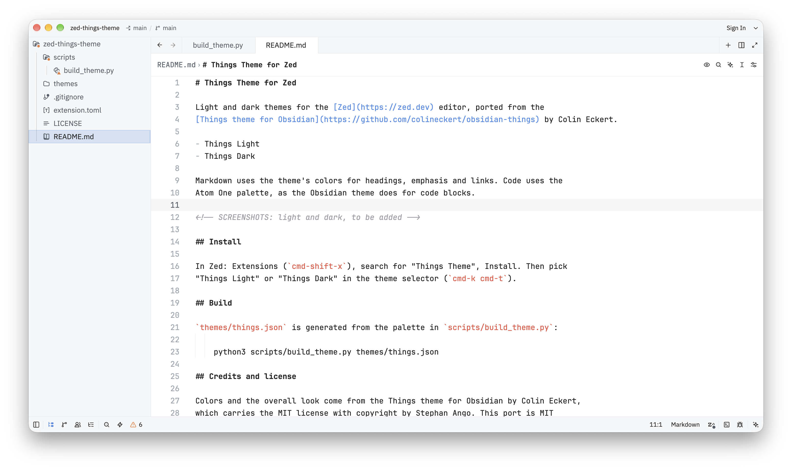
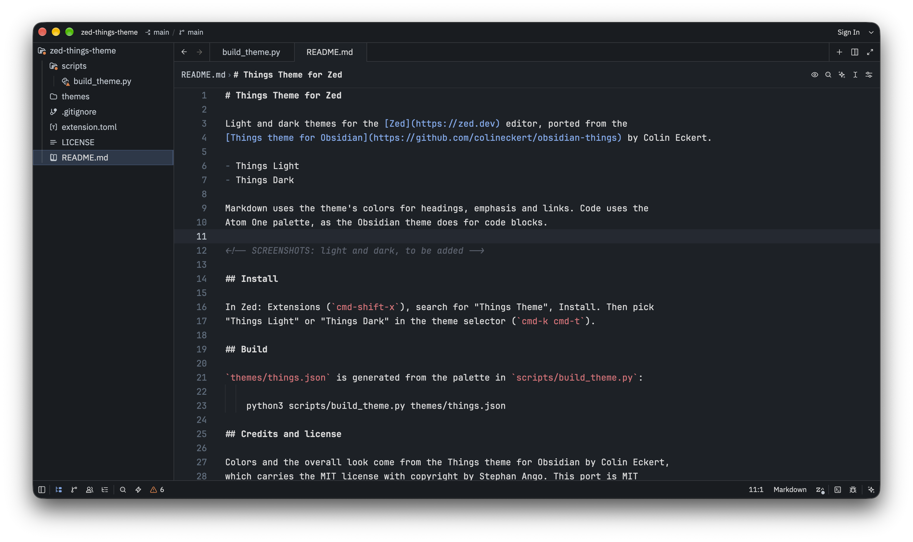

# Things Theme for Zed

Light and dark themes for the [Zed](https://zed.dev) editor, ported from the
[Things theme for Obsidian](https://github.com/colineckert/obsidian-things) by Colin Eckert.

- Things Light
- Things Dark

Markdown uses the theme's colors for headings, emphasis and links. Code uses the
Atom One palette, as the Obsidian theme does for code blocks.

## Install

In Zed: Extensions (`cmd-shift-x`), search for "Things Theme", Install. Then pick
"Things Light" or "Things Dark" in the theme selector (`cmd-k cmd-t`).

## Build

`themes/things.json` is generated from the palette in `scripts/build_theme.py`:

    python3 scripts/build_theme.py themes/things.json

## Credits and license

Colors and the overall look come from the Things theme for Obsidian by Colin Eckert,
which carries the MIT license with copyright by Stephan Ango. This port is MIT
licensed as well; see `LICENSE` for both notices.

Not affiliated with Cultured Code, the makers of the Things app, or with Obsidian.
